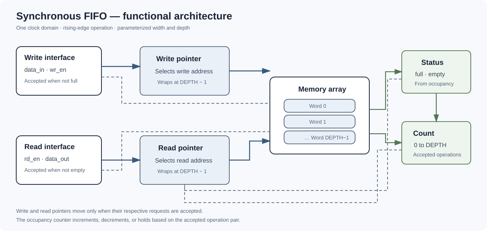

# Synchronous FIFO

[](https://github.com/saiv9/synchronous-fifo-verilog/actions/workflows/rtl-simulation.yml)

A parameterized, single-clock FIFO implemented in Verilog HDL. The design stores incoming words and returns them in first-in, first-out order when read requests are accepted.

## Design features

- Configurable data width and FIFO depth
- Independent read and write requests
- Full, empty, and occupancy outputs
- Explicit pointer wrap-around, including non-power-of-two depths
- Protection against writes while full and reads while empty
- Simultaneous accepted read and write handling
- Registered read data output
- Self-checking testbench with a reference model

## Architecture



The write and read pointers use the same clock. An occupancy counter tracks the number of stored words and drives the status flags. Each pointer wraps at `DEPTH - 1`, so configurations such as depth 5 do not rely on binary overflow.

## Interface

| Signal | Direction | Description |
|---|---|---|
| `clk` | Input | Common clock; operations occur on its rising edge |
| `rst` | Input | Synchronous, active-high reset |
| `wr_en` | Input | Requests a write when the FIFO is not full |
| `rd_en` | Input | Requests a read when the FIFO is not empty |
| `data_in` | Input | Word to store on an accepted write |
| `data_out` | Output | Registered word from the last accepted read |
| `full` | Output | High when `count == DEPTH` |
| `empty` | Output | High when `count == 0` |
| `count` | Output | Number of stored words |

### Parameters

| Parameter | Default | Description |
|---|---:|---|
| `DATA_WIDTH` | 8 | Number of bits in each word |
| `DEPTH` | 16 | Number of words the FIFO can hold; must be at least 1 |
| `ADDR_WIDTH` | Derived | Pointer width |
| `COUNT_WIDTH` | Derived | Occupancy counter width |

## Read and write behavior

A write is accepted when `wr_en && !full`. A read is accepted when `rd_en && !empty`.

When both operations are accepted on the same rising edge, one word is written and one word is read, so occupancy remains unchanged. At full capacity, a simultaneous request accepts the read but rejects the write. When empty, it accepts the write but rejects the read. The newly written word can be read on a later clock edge.

The memory array is not cleared by reset. Reset clears the pointers, occupancy counter, and output register. Memory contents are not valid FIFO data while `empty` is asserted.

## Run the simulation

Install Icarus Verilog, then run from the repository root:

```bash
bash scripts/run_sim.sh
```

The script runs the self-checking testbench at depths 8 and 5. The depth-5 run checks non-power-of-two pointer wrap-around. Each run checks reset, empty/full protection, FIFO ordering, simultaneous operations, mixed traffic, occupancy, and status flags.

The script writes logs and VCD files to `build/`. Open a waveform with GTKWave, for example:

```bash
gtkwave build/sync_fifo_depth8.vcd
```

GitHub Actions runs both configurations on pushes and pull requests and uploads the logs and waveforms as an artifact.

## Repository layout

```text
rtl/sync_fifo.v                 FIFO RTL
tb/tb_sync_fifo.v               Self-checking testbench
scripts/run_sim.sh               Local simulation script
docs/fifo_architecture.svg       Block diagram
docs/verification_plan.md        Test plan
.github/workflows/               Automated simulation
```

## Scope

This is a synchronous FIFO; read and write operations share one clock. The read output is registered and updates after an accepted read. The project does not include asynchronous clock-domain crossing logic or claim timing closure on a particular FPGA or ASIC device.

## License

MIT. See [LICENSE](LICENSE).
